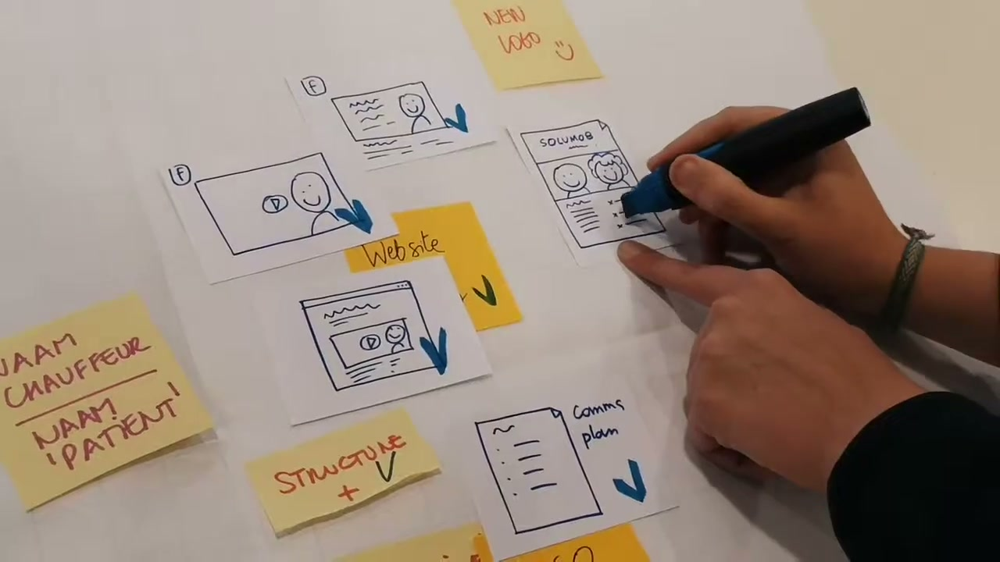
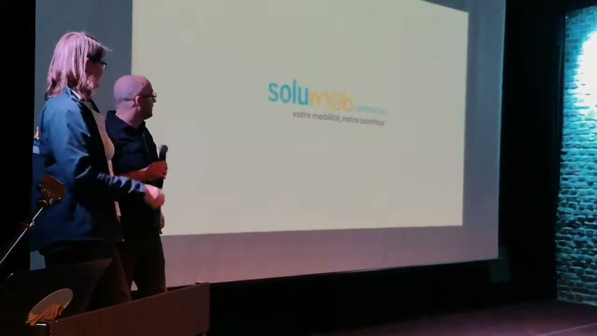

# Solumob videobewijs voor de casestudy

De video laat zien hoe het Solumob-team op één dag aan een samenhangend
communicatiepakket werkt: doelgroepverkenning, een communicatieplan, een
baseline, een kort filmpje, fotografie, een flyer en een homepage-update.
Het sterkste bewijs van een gepresenteerd resultaat is het filmpje, dat tijdens
de avondpresentatie wordt afgespeeld, gevolgd door de baseline
"votre mobilité, notre bonheur". De video toont ook veel tussenwerk. Voor de
casestudy moeten die twee soorten bewijs herkenbaar blijven.
[Werkoverzicht 02:09](../../raw/assets/solumob-2019/0209-output-map.jpg),
[filmspeler 02:26](../../raw/assets/solumob-2019/0226-film-player.jpg),
[baseline 02:38](../../raw/assets/solumob-2019/0238-presented-baseline.jpg).

**De video gaat over 16 maart 2019. De bijgevoegde aanvraag is een heraanvraag
voor 2020.** De computerdatum in de video, de eerdere introductie van de
2019-organisaties en de terugblik in de aanvraag ondersteunen die scheiding.
De aanvraag uit 2020 is bruikbaar als organisatiecontext en als terugblik op
2019, maar is geen oorspronkelijke briefing van de gefilmde dag.
[Computerdatum 01:52](../../raw/assets/solumob-2019/0152-computer-date.jpg),
[2019-introductie p. 2](../../raw/assets/solumob-2019/2019-pdf-excerpts.md#meet-the-brussels-nonprofits),
[aanvraag, rij 2, kolom 10](../../raw/assets/solumob-2019/application-selected-fields.json).

## Bronnen en bewijskracht

- **V** is de aangeleverde vlog, 03:09 lang. Tijdcodes hieronder zijn verstreken videotijd. Geselecteerde frames zijn lokaal bewaard en rechtstreeks gelinkt. De [bronregistratie](../../raw/2026-10-19-solumob-video-sources.md) beschrijft de inspectie en verwijst naar het originele bestand.
- **A** is de aanvraag voor 2020. Verwijzingen noemen CSV-rij 2 en het kolomnummer. De [geselecteerde velden](../../raw/assets/solumob-2019/application-selected-fields.json) bewaren de oorspronkelijke waarden en kolomkoppen.
- **T** is het [meegeleverde transcript](../../raw/assets/solumob-2019/supplied-transcript.txt). Het heeft geen tijdcodes en bevat herkenningsfouten. Het is geen volledige beschrijving van de beelden.
- **S** is een aanvullende [lokale automatische transcriptie met tijdcodes](../../raw/assets/solumob-2019/automatic-transcription-notes.md). De herkenning is niet handmatig tegen de audio gecontroleerd. Ze helpt passages terugvinden; onduidelijke namen en zinnen zijn geen citaatbewijs.
- **P** zijn twee eerder aangeleverde artikelen over 2019. De [bewaarde passages met PDF-paginanummers](../../raw/assets/solumob-2019/2019-pdf-excerpts.md) geven extra context over datum, missie en locaties.

Een zichtbare titel bewijst dat de vlog een activiteit zo benoemt. Een
werkbeeld bewijst dat eraan gewerkt wordt. Een getoond eindresultaat ondersteunt
een sterkere claim. Geen van die drie bewijst op zichzelf publicatie,
bestandsoverdracht of effect na het evenement. Dat onderscheid bepaalt de
formuleringen hieronder.

## De organisatie en haar communicatievraag

De bronspelling is **Solumob Volontaires ASBL**. De introductie uit 2019
beschrijft begeleid vervoer voor mensen met beperkte mobiliteit in Brussel,
Waals-Brabant en het Waalse Gewest. Vrijwilligers gebruiken hun eigen voertuig.
Vertrouwen, luisteren, uitwisseling en respect horen volgens die introductie
bij de dienstverlening. [P, introductie p. 13](../../raw/assets/solumob-2019/2019-pdf-excerpts.md#meet-the-brussels-nonprofits).

De bestaande flyer in de video noemt "Transport et accompagnement" en geeft
voorbeelden: ziekenhuizen, artsen, kinesisten, tandartsen, activiteiten,
familiebezoek en boodschappen. De tekst noemt mensen met een beperking,
mensen met beperkte mobiliteit en zieken. Het communicatieprobleem speelt dus
rond een concrete dienst met zowel een vervoersfunctie als persoonlijk contact.
De laatste zin is een interpretatie van de combinatie van beide bronnen.
[V 01:08](../../raw/assets/solumob-2019/0108-existing-flyer.jpg).

De aanvraag voor 2020 legt een groeivraag vast. Solumob wil de dienstverlening
uitbreiden en heeft daarvoor meer vrijwilligers nodig. Volgens de aanvraag
is Facebook op dat moment het enige gebruikte sociale netwerk en ontbreekt
marketingexpertise in het team. De organisatie vraagt een "Social media toolkit",
advies over kanalen, goede video's en relevante teksten. Facebook, Instagram,
eventueel LinkedIn en Google SEO worden als mogelijkheden genoemd.
[A, kolommen 7, 8 en 9](../../raw/assets/solumob-2019/application-selected-fields.json).

**Interpretatie voor het verhaal:** de beelden van chauffeur, passagier en
onderlinge omgang maken de menselijke kant van de dienst zichtbaar. Dat past
bij de missie uit 2019 en bij de latere behoefte aan herkenbare communicatie.
De oorspronkelijke ontwerpvraag van 2019 staat niet in de beschikbare
introductie. Schrijf daarom nog niet dat het team in 2019 precies de
socialmedia-opdracht uit de aanvraag van 2020 uitvoerde.
[V 01:21 en 01:25](../../raw/assets/solumob-2019/0121-transport-scene.jpg),
[P, introductie p. 13](../../raw/assets/solumob-2019/2019-pdf-excerpts.md#meet-the-brussels-nonprofits),
[A, kolommen 7 tot 10](../../raw/assets/solumob-2019/application-selected-fields.json).

## Wat het team maakt

| Onderdeel | Wat de video bewijst | Bruikbare formulering voor de casestudy |
| --- | --- | --- |
| Doelgroepverkenning | De titel "Doelgroep verkennen" staat boven overleg rond geprinte profielen op de muur. De exacte profielteksten zijn te klein om betrouwbaar over te nemen. V circa 00:58 tot 01:06; [frame 01:05](../../raw/assets/solumob-2019/0105-audience.jpg). | "Het team begon met het verkennen van de doelgroepen." |
| Communicatieplan | De titel "Communicatieplan" verschijnt tijdens gezamenlijk laptopwerk. Op de werkkaart staan "Comms plan" en schetsen voor Facebook, website en drukwerk. De volledige planinhoud is niet leesbaar. V circa 01:10 en 02:09; [werkkaart](../../raw/assets/solumob-2019/0209-output-map.jpg). | "Het team werkte aan een communicatieplan dat verschillende middelen met elkaar verbond." |
| Structuur en tone of voice | Een post-it vermeldt letterlijk "STRUCTURE + TONE OF VOICE". Later staat een vinkje bij "STRUCTURE +". Dit bewijst een werkonderdeel, geen bewaard volledig stijldocument. V 00:45 en 02:09; [bord](../../raw/assets/solumob-2019/0045-structure-tone.jpg), [werkkaart](../../raw/assets/solumob-2019/0209-output-map.jpg). | "Ook structuur en tone of voice kwamen aan bod." |
| Baseline | De vlog benoemt "Nieuwe baseline". Er staan ideeën op een flip-over; aan het eind verschijnt "votre mobilité, notre bonheur" onder het logo. V circa 01:12 tot 01:16 en 02:38 tot 02:41; [ideeën](../../raw/assets/solumob-2019/0112-baseline-ideas.jpg), [presentatie](../../raw/assets/solumob-2019/0238-presented-baseline.jpg). | "Tijdens de presentatie toonde het team de baseline ‘votre mobilité, notre bonheur’." |
| Kort filmpje | De vlog toont opnames, montage met materiaal van Thierry in de auto en het afspelen tijdens de presentatie. De speler vermeldt 0:00 / 0:56. V circa 01:18 tot 01:33 en 02:26 tot 02:37; [montage](../../raw/assets/solumob-2019/0132-editing.jpg), [speler](../../raw/assets/solumob-2019/0226-film-player.jpg). | "Het team maakte een filmpje van ongeveer 56 seconden, dat die avond werd vertoond." |
| Fotografie | "Fotoshoot" staat in beeld terwijl een fotograaf mensen bij een auto en op straat fotografeert. De opnameactiviteit is duidelijk; de uiteindelijke fotoselectie wordt niet getoond. V circa 01:35 tot 01:42; [frame](../../raw/assets/solumob-2019/0138-photoshoot.jpg). | "Een fotoshoot legde de mensen en dienstverlening in beeld vast." |
| Flyer | De titel "Flyer maken" verschijnt bij het team dat op laptops werkt. De eerder getoonde papieren flyer ligt al tijdens de verkenning op tafel. Geen leesbaar definitief nieuw ontwerp in beeld. V circa 01:43 tot 01:46; [werkbeeld](../../raw/assets/solumob-2019/0144-flyer-work.jpg), [eerder drukwerk](../../raw/assets/solumob-2019/0108-existing-flyer.jpg). | "Het team werkte aan een flyer." Nog niet: "Deze afgebeelde flyer is die dag ontworpen." |
| Homepage-update | De vlog benoemt "Homepage update". Daarna is een editor zichtbaar met template "SOLUMOB" en instellingen voor knopstijlen. Er is geen scherp leesbare volledige eindpagina. V circa 01:58 tot 02:03; [werkbeeld](../../raw/assets/solumob-2019/0158-homepage-work.jpg), [editor](../../raw/assets/solumob-2019/0202-template-editing.jpg). | "Ook de bestaande homepage werd onder handen genomen." Nog niet: "Het team bouwde een nieuwe website." |
| Logo | Op de werkkaart staat "NEW LOGO". Het blauw/gele Solumob-logo is echter ook al op het vroege drukwerk en op jassen zichtbaar. De video maakt de precieze wijziging niet duidelijk. [Werkkaart 02:09](../../raw/assets/solumob-2019/0209-output-map.jpg), [vroeg drukwerk 01:08](../../raw/assets/solumob-2019/0108-existing-flyer.jpg). | Alleen beschrijven als werkspoor tot een ontwerper bevestigt wat nieuw of aangepast was. Geen volledige rebranding claimen. |

### Het filmpje als sterkste resultaat

De vlog toont eerst de productie in de praktijk: mensen vertrekken vanuit een
garage, een oudere vrouw stapt bij een auto in, er worden opnames in de auto
gemaakt en Thierry komt als vrijwilliger in beeld. De tussentitel noemt de
vrouw "de bomma van Cindy, fris van de kapper". De scène is dus met iemand uit
de omgeving van het team opgenomen. De vlog bewijst niet dat deze vrouw een
echte Solumob-klant is of dat een volledige reguliere rit werd gedocumenteerd.
[V circa 01:18 tot 01:30](../../raw/assets/solumob-2019/0121-transport-scene.jpg).

Bij de montage staat een project met Solumob-materiaal open, met Thierry
zichtbaar in de videomonitor. Tijdens de avondpresentatie keren de
vervoersbeelden en Thierry op straat terug op het projectiescherm.
Die keten maakt de verbinding tussen opname, montage en vertoond werk
aantoonbaar. Het gaat hier om het korte filmpje voor Solumob. De aangeleverde
vlog van 03:09 is een afzonderlijke film over de dag.
[V 01:32](../../raw/assets/solumob-2019/0132-editing.jpg),
[V 02:26](../../raw/assets/solumob-2019/0226-film-player.jpg),
[V 02:34](../../raw/assets/solumob-2019/0234-film-screening.jpg).

**Interpretatie:** dit is een geschikt hoofdonderdeel van de casestudy omdat
het een concreet resultaat aan een zichtbaar maakproces koppelt. Gebruik
bijvoorbeeld een drieluik van opname, montagescherm en presentatie. Voor
publicatie verdient het originele filmpje de voorkeur boven een opname van
het projectiescherm.

### Van functionele beschrijving naar een menselijke belofte

Het vroege drukwerk legt uit wat Solumob doet met "Transport et accompagnement".
Op de flip-over staat onder meer "Smile on wheels" als idee. De uiteindelijke
presentatie toont "votre mobilité, notre bonheur". "Smile on wheels" mag
daarom als verkende richting worden beschreven, niet als gekozen eindbaseline.
[V 01:08](../../raw/assets/solumob-2019/0108-existing-flyer.jpg),
[V 01:12](../../raw/assets/solumob-2019/0112-baseline-ideas.jpg),
[V 02:38](../../raw/assets/solumob-2019/0238-presented-baseline.jpg).

**Interpretatie:** de gepresenteerde baseline legt naast de mobiliteit van de
passagier ook het plezier van de helper in de boodschap. Dat sluit aan bij de
aanvraag, die zowel het welzijn van begunstigden als dat van vrijwilligers
benoemt. Het is een inhoudelijk aanknopingspunt voor een gesprek met de
makers; de video bevat geen volledige uitleg van de keuze.
[A, kolommen 5, 6 en 8](../../raw/assets/solumob-2019/application-selected-fields.json).

### Een pakket dat over verschillende kanalen werkt

De werkkaart rond 02:09 verbindt schetsen van een Facebookvideo, een
Facebookbericht, een webpagina met video, een flyer en een communicatieplan.
Blauwe pijlen en een vinkje maken het ook een voortgangsoverzicht. Het is een
sterk beeld voor de breedte van de opdracht, maar de schetsen zelf zijn geen
afgewerkte kanaalontwerpen. De notitie "NEW LOGO" is evenmin voldoende om te
zeggen dat het hele logo die dag is ontworpen.
[V 02:09](../../raw/assets/solumob-2019/0209-output-map.jpg).

**Interpretatie:** het interessantste verhaal is hoe strategie, tekst,
fotografie, film en digitale uitvoering binnen dezelfde dag samenkwamen.
De werkkaart kan die samenhang in één beeld uitleggen. Het dossier telt
communicatieplan, structuur en tone of voice daarom niet als drie bewezen
losse opgeleverde documenten.

## Het verloop en de rush van de dag

| Videotijd | Wat te zien of te lezen is | Betekenis voor de casestudy |
| --- | --- | --- |
| 00:00 tot 00:11 | Intro met "Make a Mark BRUSSELS", "Make-a-thon", "Eén dag", "Zestien non-profits" en "50+ creatievelingen". | Eventcontext volgens de vlog; de aantallen gelden niet voor het Solumob-team. Zie ook de bronverschillen hieronder. |
| 00:12 tot 00:31 | Aankomst in Brussel en introductie door de vlogger. Het transcript noemt Make a Mark en de daglocatie. | Persoonlijk perspectief op de dag, geen onafhankelijk resultaatbewijs. [T](../../raw/assets/solumob-2019/supplied-transcript.txt). |
| 00:32 tot 00:38 | Onthaal, algemene briefing en de correctie "9 uur". | De film maakt de tijdslimiet expliciet. [Frame 00:35](../../raw/assets/solumob-2019/0035-duration-correction.jpg). |
| 00:38 tot 00:48 | Team aan tafel en een werkbord met getekende portretjes en namen. | Het werk heeft een herkenbaar team achter zich. [Team](../../raw/assets/solumob-2019/0038-team.jpg), [bord](../../raw/assets/solumob-2019/0044-team-board.jpg). |
| 00:48 tot 00:58 | Korte introducties van organisatie en teamleden. Het transcript noemt Cindy en Thierry; Thierry wordt chauffeur/begeleider genoemd. | Organisatiekennis en praktijkervaring zijn aanwezig in de werksituatie. [T](../../raw/assets/solumob-2019/supplied-transcript.txt). |
| 00:58 tot 01:06 | "Nog 9u", "Doelgroep verkennen" en bespreking bij de profielen. | Eerst begrijpen voor er middelen gemaakt worden. [Frame 01:05](../../raw/assets/solumob-2019/0105-audience.jpg). |
| 01:06 tot 01:10 | Bestaand drukwerk en post-its met onder meer "FOTO", "TESTIMONIAL", "POSTER" en "TITEL". | Tastbaar materiaal en inhoudelijke bouwstenen op tafel. Geen bewijs dat elk genoemd middel af is. [Frame 01:08](../../raw/assets/solumob-2019/0108-existing-flyer.jpg). |
| 01:10 tot 01:16 | "Nog 7u", communicatieplan en baseline-ideeën. | Strategie en copywriting lopen naast elkaar. [Plan](../../raw/assets/solumob-2019/0110-communication-plan.jpg), [baseline](../../raw/assets/solumob-2019/0112-baseline-ideas.jpg). |
| 01:18 tot 01:30 | "Nog 6u30", "Filmke schieten", garage, auto, passagier en Thierry. | Het team gaat naar buiten om eigen materiaal te maken. [Filmen](../../raw/assets/solumob-2019/0118-filming.jpg), [auto](../../raw/assets/solumob-2019/0125-car-scene.jpg). |
| 01:31 tot 01:34 | "Monteren maar" en videomontage op de laptop. | Dezelfde dag gaat het materiaal de montage in. [Frame](../../raw/assets/solumob-2019/0132-editing.jpg). |
| 01:35 tot 01:42 | "Nog 3u30", "Fotoshoot", fotografie bij de auto en op straat. | Een tweede soort eigen beeldmateriaal wordt gemaakt. [Frame](../../raw/assets/solumob-2019/0138-photoshoot.jpg). |
| 01:43 tot 01:51 | "Nog 2u", "Flyer maken" en werken op laptops. | Er wordt aan meerdere middelen doorgewerkt dicht bij de deadline. [Frame](../../raw/assets/solumob-2019/0144-flyer-work.jpg). |
| 01:51 tot 01:58 | Close-up van de computerklok: zaterdag 16 maart 2019, circa 15:52. Daarna een update door de vlogger. | Sterk bewijs voor de editie en een expliciet tijdsanker. [Frame](../../raw/assets/solumob-2019/0152-computer-date.jpg). |
| 01:58 tot 02:03 | "Nog 1u30", "Homepage update" en werken in de editor. | Digitale uitvoering gaat tot laat op de dag door. [Frame](../../raw/assets/solumob-2019/0158-homepage-work.jpg). |
| 02:03 tot 02:11 | Laatste update aan tafel, werkoverzicht en opruimen. Het transcript bevat "Nog een kwartier te gaan". | Een bruikbaar sluitstuk van de maakfase. [Werkkaart](../../raw/assets/solumob-2019/0209-output-map.jpg), [T](../../raw/assets/solumob-2019/supplied-transcript.txt). |
| 02:12 tot 02:25 | Wandeling, de gevel met "beursschouwburg", avondpubliek en presentaties. | De werkdag krijgt een gezamenlijke afsluiting op een tweede locatie. [Gevel](../../raw/assets/solumob-2019/0216-evening-venue.jpg), [P, recap p. 6](../../raw/assets/solumob-2019/2019-pdf-excerpts.md#make-a-mark-brussels-2019-recap). |
| 02:26 tot 02:41 | Het Solumob-filmpje speelt, gevolgd door het logo met de baseline. | Het duidelijkste bewijs van een getoond resultaat. [Film](../../raw/assets/solumob-2019/0226-film-player.jpg), [baseline](../../raw/assets/solumob-2019/0238-presented-baseline.jpg). |
| 02:42 tot 03:09 | Andere presentatiebeelden, bedankmoment, applaus, persoonlijke terugblik en sociale afsluiting. | Sfeer en afsluiting; geen bewijs van langetermijneffect bij Solumob. De twee schermbeelden rond 02:43 zijn niet leesbaar genoeg om aan Solumob toe te schrijven. |

**Interpretatie van het tempo:** de aftellende tussentitels, de afwisseling
tussen overleg en productie, de laptoptafels en de avondvertoning maken de
tijdsdruk concreet. Voor een case is dat sterker dan alleen zeggen dat het
een "intense dag" was. Een reeks van vier momenten kan dat vertellen:
doelgroepen, buitenopnames, laatste homepagewerk en de vertoning.
[V 01:05](../../raw/assets/solumob-2019/0105-audience.jpg),
[01:18](../../raw/assets/solumob-2019/0118-filming.jpg),
[01:58](../../raw/assets/solumob-2019/0158-homepage-work.jpg),
[02:26](../../raw/assets/solumob-2019/0226-film-player.jpg).

De recap uit 2019 beschrijft ook deadlinepaniek en extra afwerktijd voor de
makers. Dat ondersteunt de ervaring van een deadline, maar bewijst niet hoeveel
extra tijd het Solumob-team kreeg.
[P, recap p. 5](../../raw/assets/solumob-2019/2019-pdf-excerpts.md#make-a-mark-brussels-2019-recap).

## Mensen en samenwerking

Het bord bevat leesbare voornamen Thierry, Cindy, Emilie, Annelies en Ellen.
De vlog is volgens de eigenaar door hem gemaakt en hij maakte deel uit van
het team. De aanvraag uit 2020 spreekt over het eerdere werk van vier experts.
Dat is nog geen volledige creditslijst: verbind geen specifieke ontwerpdiscipline
of achternaam aan een portret zonder bevestiging.
[Bord 00:44](../../raw/assets/solumob-2019/0044-team-board.jpg),
[00:45](../../raw/assets/solumob-2019/0045-structure-tone.jpg),
[00:47](../../raw/assets/solumob-2019/0047-baseline-board.jpg),
[eigenaarscontext](../../raw/2026-10-19-solumob-video-sources.md#owner-request),
[A, kolom 10](../../raw/assets/solumob-2019/application-selected-fields.json).

**Interpretatie:** het overleg aan tafel, het gezamenlijk bekijken van schermen
en het meenemen van een chauffeur in de opnames geven aanknopingspunten om
over samenwerking met de organisatie te vertellen. De casestudy kan later
verduidelijken welke kennis Cindy en Thierry inbrachten en wie de vier makers
waren. De beelden geven geen volledig besluitvormingsverslag.
[V 01:05](../../raw/assets/solumob-2019/0105-audience.jpg),
[01:25](../../raw/assets/solumob-2019/0125-car-scene.jpg),
[01:58](../../raw/assets/solumob-2019/0158-homepage-work.jpg).

## Wat de aanvraag achteraf toevoegt

De belangrijkste terugblik staat in kolom 10 van de aanvraag voor 2020:

> Ayant eu la chance de participer à l'édition 2019 et ayant eu de très bons retours du travail effectué par les 4 experts, nous retentons notre chance pour permettre à notre asbl de se développer.

[A, rij 2, kolom 10](../../raw/assets/solumob-2019/application-selected-fields.json).

Een Nederlandse vertaling voor intern gebruik: "We hadden het geluk aan de
editie van 2019 deel te nemen. We kregen heel goede reacties op het werk van
de vier experts en wagen opnieuw onze kans om onze vzw verder te laten groeien."
Dit is een vertaling van een geschreven aanvraag, geen gesproken citaat uit
de video.

Dit ondersteunt de claims dat Solumob in 2019 deelnam, naar eigen zeggen
goede reacties kreeg op het gemaakte werk en opnieuw wilde deelnemen.
"De samenwerking smaakte naar meer" is een mogelijke redactionele
interpretatie. De bron zegt niet wie de reacties gaf, op welke middelen ze
betrekking hadden of wat er meetbaar veranderde.
[A, kolom 10](../../raw/assets/solumob-2019/application-selected-fields.json).

De organisatie beschrijft daarnaast het welzijn van begunstigden en
vrijwilligers als doelen, en aankondigingen op sociale media als naar eigen ervaring
redelijk effectief. Dat zijn eigen uitspraken over missie en communicatie,
geen bewezen effecten van het werk uit 2019. Er staan geen aantallen extra
vrijwilligers, ritten, aanvragen of conversies in de geselecteerde
aanvraagvelden. [A, kolommen 6, 8 en 9](../../raw/assets/solumob-2019/application-selected-fields.json).

## Gesproken passages met tijdcodes

De aanvullende transcriptie geeft de gesproken passages een tijdsanker.
Onderstaande beschrijvingen zijn werknotities naast het meegeleverde transcript,
geen gecorrigeerde letterlijke transcriptie. De Franse introducties en spraak
over muziek worden ook in de lokale herkenning regelmatig verkeerd verstaan.
[S, methode en bestanden](../../raw/assets/solumob-2019/automatic-transcription-notes.md).

| Tijdcode bij benadering | Inhoud en bruikbaarheid |
| --- | --- |
| 00:20 tot 00:23 | De vlogger situeert Make a Mark in Muntpunt in Brussel. Die plaatsnaam wordt ondersteund door de recap. [S](../../raw/assets/solumob-2019/transcription_small_timestamped.txt), [P, recap p. 2](../../raw/assets/solumob-2019/2019-pdf-excerpts.md#make-a-mark-brussels-2019-recap). |
| 00:24 tot 00:32 | De introductie beschrijft ongeveer vijftig creatieve mensen die problemen van lokale non-profits proberen op te lossen. De uitspraak over het aantal uren blijft in de herkenning "11 uur"; de montage corrigeert later naar negen. [S](../../raw/assets/solumob-2019/transcription_small_timestamped.txt), [V 00:35](../../raw/assets/solumob-2019/0035-duration-correction.jpg). |
| 00:47 tot 00:58 | Korte introducties, waaronder een verantwoordelijke van de organisatie en een chauffeur/begeleider. Gebruik voor namen het bord en bevestiging door het team, want de automatische herkenning van het Frans is zwak. [T](../../raw/assets/solumob-2019/supplied-transcript.txt), [S](../../raw/assets/solumob-2019/transcription_small_timestamped.txt). |
| Circa 01:46 tot 01:50 | Het meegeleverde transcript bevat de update dat het drie uur is en er nog twee uur is om af te werken. De beeldmontage toont in deze fase ook "Nog 2u". De precieze uitspraak vraagt audiocontrole. [T](../../raw/assets/solumob-2019/supplied-transcript.txt), [V](../../raw/assets/solumob-2019/0144-flyer-work.jpg). |
| Circa 01:55 | "Gas geven!" staat zowel in het meegeleverde transcript als in de lokale herkenning. Een mogelijke korte procesquote, nog tegen de audio controleren voor publicatie. [T](../../raw/assets/solumob-2019/supplied-transcript.txt), [S](../../raw/assets/solumob-2019/transcription_small_timestamped.txt). |
| 02:04 tot 02:08 | De update noemt nog een kwartier. Het vervolg van die zin verschilt tussen de twee transcripties en wordt niet als exact citaat overgenomen. [T](../../raw/assets/solumob-2019/supplied-transcript.txt), [S](../../raw/assets/solumob-2019/transcription_small_timestamped.txt). |
| 02:52 tot 03:00 | Persoonlijke terugblik van de vlogger. De eerste zin wordt te slecht herkend om betrouwbaar te transcriberen. Beide lokale passages herkennen aan het slot de wens dat dit vaker gebeurt en een afscheid tot volgend jaar. Dit is het perspectief van de maker, geen Solumob-testimonial. [S, volledige passage](../../raw/assets/solumob-2019/transcription_small_raw.json), [afzonderlijke herkenning vanaf 02:51](../../raw/assets/solumob-2019/transcription_small_closing_raw.json). |

## Citaten en bronverschillen

| Materiaal | Status en gebruik |
| --- | --- |
| "votre mobilité, notre bonheur" | Leesbaar gepresenteerde baseline. Bruikbaar als ontwerptekst, niet als testimonial. [V 02:38](../../raw/assets/solumob-2019/0238-presented-baseline.jpg). |
| "Smile on wheels" | Leesbaar brainstormidee op de flip-over. Alleen gebruiken om de verkenning te laten zien. [V 01:12](../../raw/assets/solumob-2019/0112-baseline-ideas.jpg). |
| "Nog 9u", "Nog 7u", "Nog 6u30", "Nog 3u30", "Nog 2u", "Nog 1u30" | Tussentitels uit de montage. Bruikbaar voor tempo en proces, geen sluitende urenregistratie. Zie de tijdlijn. |
| "Gas geven!" en "Nog een kwartier te gaan" | Staan in het aangeleverde transcript. Voor een letterlijk gepubliceerd gesproken citaat nog controleren tegen de audio; het transcript bevat geen tijdcodes. [T](../../raw/assets/solumob-2019/supplied-transcript.txt). |
| Naamvarianten in het transcript | "Solimop", "Münpunt", "Théry" en andere vormen zijn herkenningsvarianten. Gebruik de naam uit de aanvraag, Muntpunt uit de recap en Thierry van het bord. [T](../../raw/assets/solumob-2019/supplied-transcript.txt), [A](../../raw/assets/solumob-2019/application-selected-fields.json), [P](../../raw/assets/solumob-2019/2019-pdf-excerpts.md). |
| Acht, negen, elf of twaalf uur | De bestandsnaam noemt acht uur, het transcript bevat "11 uur", de montage corrigeert naar negen uur en de recap noemt werk in twaalf uur. Het verschil wordt niet verklaard. Gebruik voorlopig "in één dag". [Correctie](../../raw/assets/solumob-2019/0035-duration-correction.jpg), [T](../../raw/assets/solumob-2019/supplied-transcript.txt), [P, recap p. 7](../../raw/assets/solumob-2019/2019-pdf-excerpts.md#make-a-mark-brussels-2019-recap). |
| Veertien of zestien organisaties | De intro van de vlog noemt zestien; het vooraf gepubliceerde artikel noemt veertien geselecteerde organisaties. Dit kan verschillende telmomenten betreffen, maar dat is onbevestigd. Laat het aantal weg uit deze case. [V, intro](../../raw/2026-10-19-solumob-video-sources.md), [P, introductie p. 1](../../raw/assets/solumob-2019/2019-pdf-excerpts.md#meet-the-brussels-nonprofits). |
| 2019, 2020, 2021 of 2024 | 2019 is de gefilmde editie. 2020 is de aanvraag. "TV Gelderland 2021" aan het einde van het transcript is onbetrouwbare transcripttekst en geen datumbron. De MP4-metadata van augustus 2024 beschrijft het bestand, niet het evenement. [Datumbeeld](../../raw/assets/solumob-2019/0152-computer-date.jpg), [manifest](../../raw/assets/solumob-2019/manifest.json), [T](../../raw/assets/solumob-2019/supplied-transcript.txt). |

## Beelden om voor de casestudy te bewaren

De onderstaande selectie is een redactioneel voorstel. De links openen
ongecroppte frames uit de aangeleverde 720p-video. Voor grote publicatiebeelden
zijn originele foto's of ontwerpbestanden geschikter.

| Voorgesteld beeld | Tijdcode en bewaard frame | Waarom dit beeld helpt |
| --- | --- | --- |
| Doelgroepen aan de muur | [01:05](../../raw/assets/solumob-2019/0105-audience.jpg) | Laat zien dat het team de opdracht inhoudelijk verkent. |
| Bestaand drukwerk op de werktafel | [01:08](../../raw/assets/solumob-2019/0108-existing-flyer.jpg) | Geeft een concreet vertrekpunt. Benoem het niet als nieuw ontwerp. |
| Baseline-ideeën | [01:12](../../raw/assets/solumob-2019/0112-baseline-ideas.jpg) | Maakt het zoeken naar woorden zichtbaar. |
| Vervoersscène | [01:21](../../raw/assets/solumob-2019/0121-transport-scene.jpg) | Legt de dienst concreet uit. Benoem de scène niet als bewezen klantgetuigenis. |
| Opname in de auto | [01:25](../../raw/assets/solumob-2019/0125-car-scene.jpg) | Verbindt chauffeur en passagier met het gemaakte beeldmateriaal. |
| Montage op de laptop | [01:32](../../raw/assets/solumob-2019/0132-editing.jpg) | Bewijs van maken en afwerken op de dag zelf. |
| Fotoshoot naast de auto | [01:38](../../raw/assets/solumob-2019/0138-photoshoot.jpg) | Laat de productie van eigen fotografie zien. |
| Laatste homepagewerk | [01:58](../../raw/assets/solumob-2019/0158-homepage-work.jpg) | Combineert de aftelklok met gezamenlijk werk. |
| Getekend overzicht van de middelen | [02:09](../../raw/assets/solumob-2019/0209-output-map.jpg) | De beste overzichtsafbeelding van het pakket. |
| Filmpje tijdens de presentatie | [02:26](../../raw/assets/solumob-2019/0226-film-player.jpg) | Verbindt het resultaat met het moment waarop het wordt getoond. |
| Gepresenteerde baseline | [02:38](../../raw/assets/solumob-2019/0238-presented-baseline.jpg) | Duidelijkste eindbeeld van de gekozen boodschap. |

## Aanbevolen richting voor de casestudy

**Redactionele interpretatie:** vertel hoe het team de menselijke kant van
begeleid vervoer zichtbaar maakte en die vertaalde naar meerdere
communicatiemiddelen. Het korte filmpje en de baseline kunnen de hoofdrol
krijgen. De fotoshoot, doelgroepverkenning en werkkaart leggen uit hoe dat
resultaat in één dag tot stand kwam.

Een voorlopige, feitelijk begrensde kerntekst:

> Tijdens Make a Mark Brussels op 16 maart 2019 werkte een creatief team samen
> met Solumob Volontaires aan de communicatie van de organisatie. De dag
> combineerde doelgroepverkenning en communicatieplanning met filmopnames,
> fotografie en werk aan een flyer en homepage. Die avond toonde het team een
> kort filmpje en de baseline "votre mobilité, notre bonheur". In de aanvraag
> voor de volgende editie schreef Solumob dat het goede reacties had gekregen
> op het werk van de vier experts.

Bronnen voor deze voorlopige tekst:
[P, introductie](../../raw/assets/solumob-2019/2019-pdf-excerpts.md#meet-the-brussels-nonprofits),
[V, werkkaart](../../raw/assets/solumob-2019/0209-output-map.jpg),
[filmspeler](../../raw/assets/solumob-2019/0226-film-player.jpg),
[baseline](../../raw/assets/solumob-2019/0238-presented-baseline.jpg),
[A, kolom 10](../../raw/assets/solumob-2019/application-selected-fields.json).

## Nog nodig voor een publiceerbare resultaatcase

Deze vragen zijn vervolgonderzoek, geen voorwaarde om de videoanalyse te
gebruiken. Ze horen bij concern B-036 in het
[Build-register](01-build-concerns.md).

1. **De oorspronkelijke vraag van 2019.** Wat was de afgebakende opdracht vóór de dag begon, en welke keuzes maakte het team onderweg?
2. **De originele eindbestanden.** Het filmpje van 56 seconden, de geselecteerde foto's, de flyer, het communicatieplan en de aangepaste homepage. Wat is definitief overgedragen en wat bleef een voorstel?
3. **De precieze ontwerpwijzigingen.** Wat veranderde er aan logo, baseline, teksten en website? Het blauw/gele logo bestond zichtbaar al in vroeg materiaal.
4. **De credits.** De volledige namen van de vier experts, hun rollen en de bijdragen van Cindy en Thierry. De voornamen op het bord zijn een startpunt.
5. **Gebruik na de dag.** Welke middelen heeft Solumob gepubliceerd, gedeeld, gedrukt of intern gebruikt? Wanneer en hoe lang?
6. **Effect en een terugblik.** Op welke "goede reacties" doelde de aanvraag? Is er een concreet voorbeeld van meer aanmeldingen, duidelijkere communicatie, tijdswinst of betere zichtbaarheid? Vraag om bewijs bij cijfers en om toestemming bij een nieuw publicatiecitaat.
7. **De beelden voor publicatie.** Originele resolutie, juiste credits en toestemming voor herkenbare mensen en de geënsceneerde vervoersbeelden. Gebruik de stockfoto uit de introductie van 2019 niet als eigen Solumob-fotografie.

De onderbouwing voor de open punten staat bij de betreffende onderdelen
hierboven. Voor het stockfotocredit:
[P, introductie p. 13](../../raw/assets/solumob-2019/2019-pdf-excerpts.md#meet-the-brussels-nonprofits).
